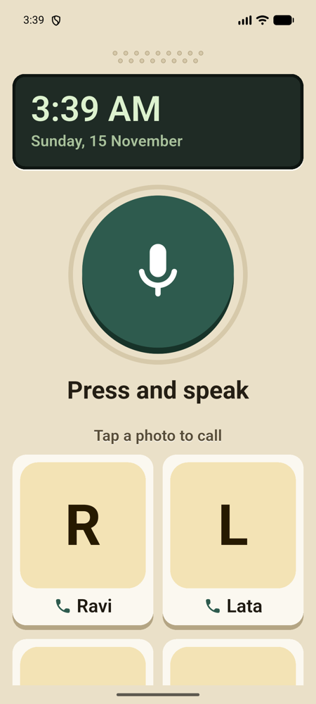
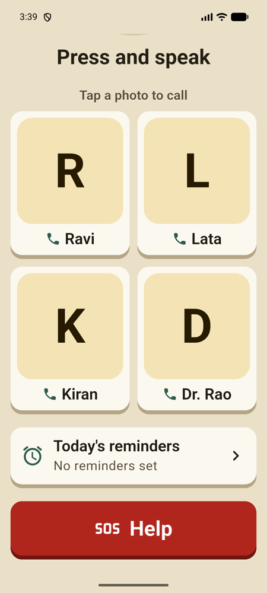
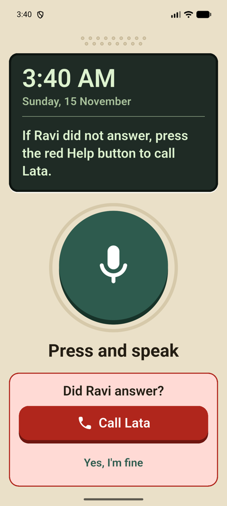
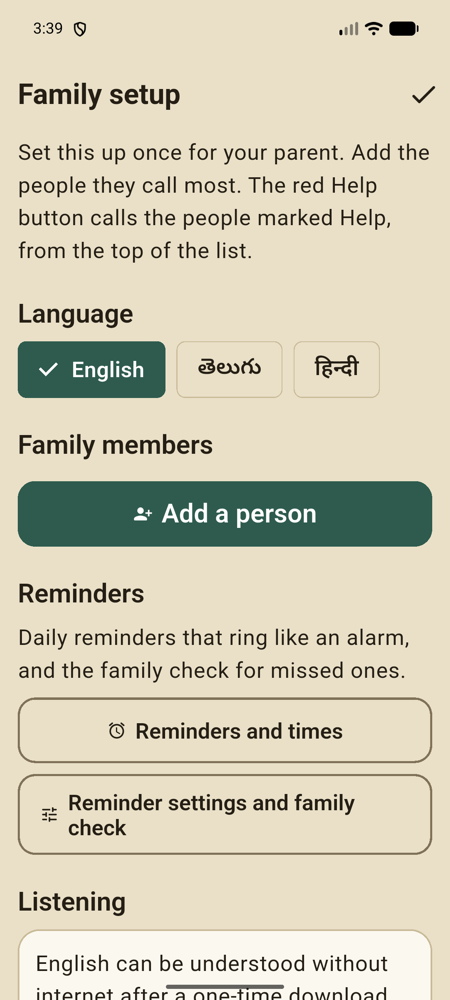
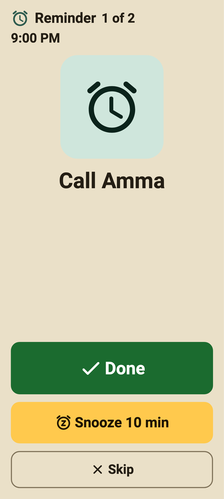
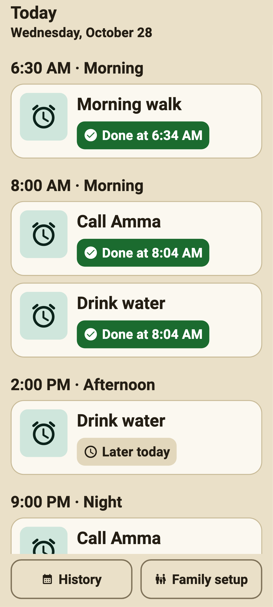
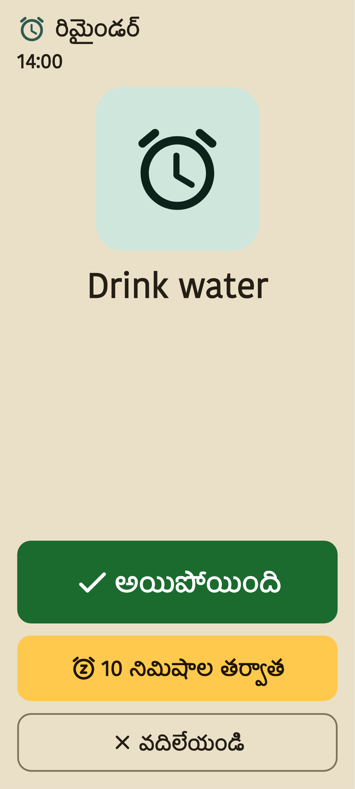
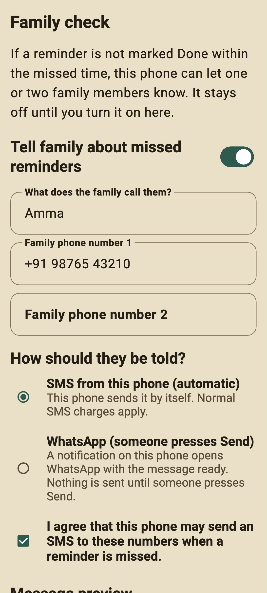

# Voice Saathi

[](https://github.com/ChandraChaan/medicine-reminder/releases/latest)
[](https://github.com/ChandraChaan/medicine-reminder/releases)
[](https://github.com/ChandraChaan/medicine-reminder/actions/workflows/ci.yml)


[](LICENSE)

**A phone helper for elderly parents that listens and reminds, built like an old push-button home phone.** They press one big button and speak in **Telugu, Hindi or English**, and the phone answers out loud: it calls a son or daughter, tells the time or the day, says what reminders are left today, reads the battery level, turns on the torch, or calls family for help. Daily reminders ring like an alarm, show the reminder in very large letters and read it out.

A son or daughter sets it up once. No account, no ads, no tracking, and no internet permission.

This app was called **Daily Reminder** until version 2.0. The package name (`dev.chandra.medicine_reminder`) is unchanged, so it updates in place and keeps your reminders.

<p align="center">
  
  
  
  
</p>
<p align="center">
  
  
  
  
</p>

> [!NOTE]
> Phones can be switched off, run out of battery or be set to silent, so please don't rely on any app alone for anything critical.

## Download

**[Download the latest APK →](https://github.com/ChandraChaan/medicine-reminder/releases/latest)**

| File | For |
|---|---|
| `MedicineReminder-<version>-arm64-v8a.apk` | Almost every phone from the last 6–7 years (pick this if unsure) |
| `MedicineReminder-<version>-armeabi-v7a.apk` | Older 32-bit phones |
| `MedicineReminder-<version>-universal.apk` | Any phone (bigger download) |

Open the file on the phone and allow installing from your browser or file manager when Android asks. Every release lists SHA-256 checksums in `SHA256SUMS`, and every APK is signed with the same release key, so new versions install as updates and keep your data.

## What your parent can say

Words can be mixed ("light on చెయ్యి" works), and each language's words are understood whatever language the app is set to.

| To | English | తెలుగు | हिन्दी |
|---|---|---|---|
| Call someone | "Call Ravi", "phone pedda abbayi", or just "Ravi" | "రవికి ఫోన్ చెయ్యి", "లతతో మాట్లాడాలి" | "रवि को फोन लगाओ", "बेटी से बात कराओ" |
| Ask for help | "Help", "emergency" | "కాపాడండి", "సహాయం" | "बचाओ", "मदद" |
| Today's reminders | "My reminders", "did I take my medicine?" | "మందులు వేసుకున్నానా?" | "आज की दवाई" |
| The time | "What time is it?" | "టైం ఎంత అయింది?" | "कितने बजे हैं?" |
| The day and date | "What day is today?" | "ఈరోజు ఏ రోజు?" | "आज कौन सा दिन है?" |
| The battery | "How much battery?" | "బ్యాటరీ ఎంత ఉంది?" | "बैटरी कितनी है?" |
| The torch | "Light on", "light off" | "లైట్ వెయ్యి", "లైట్ ఆపు" | "टॉर्च जलाओ", "लाइट बंद करो" |

If the phone doesn't catch a name, the photo keys always work.

- **Calling.** Before dialling, the phone says "Calling Ravi." With the Phone permission it calls straight away; without it, the dialer opens with the number filled in.
- **Help.** The red Help key, or saying "help", calls the people marked **Help** in the order of the family list. Back in the app after the call, it asks "Did Ravi answer?" and offers a big key to call the next person. It is not an emergency service: it calls family numbers, not 112.
- **Names the way your parent says them.** Each person can have other names ("pedda abbayi", "బాబు", "बेटा"). **Say it** listens once and saves the name exactly as the phone hears it.

### Listening and privacy

Speech is turned into text by Android's own speech recogniser, not by this app.

- **On the phone (default).** On Android 12 and newer phones with an on-device recogniser, only that one is used, so nothing your parent says leaves the phone. Family setup shows whether the language works offline and, where Google offers it, a button to download it once.
- **Online only if you switch it on.** If the language can't be recognised on the phone, listening stays off until the family turns on **Allow online listening**. That uses the phone's Google speech service, which sends the audio to Google to turn it into text.
- On a Pixel emulator with Android 17, English and Hindi could be downloaded for offline use, but Telugu was not offered offline, so Telugu needed online listening there. Other phones may differ; Family setup shows what the phone reports.

## Reminders

- **Alarms that are hard to miss.** Exact alarms that ring with the alarm sound (not a quiet notification), turn the screen on and open over the lock screen. The alarm rings for 20 seconds (or until the screen is touched), then the reminder is read out, and repeated a few times until someone answers.
- **Huge, simple alarm screen.** An optional photo and the reminder name in very large letters, then three very large buttons: **Done**, **Snooze 10 min**, **Skip**. Several reminders at the same time are shown one after another.
- **Spoken reminder** in Telugu, Hindi or English using the phone's own text-to-speech voice. If the phone has no voice for the chosen language, it speaks English instead and Settings explains how to add the voice.
- **Family check (optional, off by default).** If a reminder is not marked Done within the missed time, the phone can tell one or two family members: by **SMS sent automatically** (only after the setup person ticks a clear consent and allows SMS), or by a notification that opens a **ready-made WhatsApp message** someone sends with one tap. Nothing is ever sent unless you turn it on.
- **History calendar.** A month view of done, missed and skipped reminders, clear enough to screenshot and send to family.
- **Survives restarts.** Alarms are put back after the phone restarts, after an app update and when the time or time zone changes (an 8:00 reminder stays at 8:00 local time when you travel).
- **Made for older eyes and hands.** Big text, high contrast, colours always paired with an icon and words, at least 48 dp tap targets, few choices per screen, and layouts that still work with Android's font size at 200%.
- **Three languages throughout:** English, తెలుగు, हिन्दी.

## Setting it up for a parent (5 minutes)

1. **Install** the app on your parent's phone and open *Voice Saathi*.
2. **Pick the language** your parent reads best, then tap **Allow reminders** and allow notifications. On Android 14 and newer, also allow *Alarm over the lock screen* if Android asks.
3. In **Family setup**, add the people your parent calls (mark one or two for **Help**), allow the microphone and phone, then tap **Reminders and times → Add reminder** and answer one question per screen:
   - the **name** as your parent would say it (for example "Evening walk" or "Call Ravi") and, if you like, a **photo**;
   - **when** it should ring (morning, afternoon, night or any exact time);
   - **which days**, from which date, and until when (or no last day).
4. Repeat for each reminder. Check the **Today** screen: every reminder is listed with its time.
5. In **Family setup → Settings**, check that all three *Alarm permissions* say **On**.
6. Optional: in **Settings → Family check**, turn on *Tell family about missed reminders*, type what the family calls your parent (for example *Amma*), add one or two numbers, and choose:
   - **SMS from this phone**: tick the agreement and allow SMS. Then tap **Send a test message** to check it arrives. Normal SMS charges apply.
   - **WhatsApp**: no permission needed; when a reminder is missed, a notification on your parent's phone opens WhatsApp with the message ready, and someone presses *Send*.
7. Show your parent the alarm screen once: tap a reminder on Today to see the same big buttons.

**Tips**
- Keep the phone's **alarm volume** up (alarm volume is separate from the ringer volume).
- On some phones (Xiaomi, Redmi, Realme, Oppo, Vivo, OnePlus) set battery usage for *Voice Saathi* to **No restrictions** / **Don't optimise**, and allow **Autostart** if the phone has that setting. These phones can stop apps in the background more aggressively than Android itself.
- A reminder with no answer counts as **missed** after 1 hour by default; change it to 30 minutes or 2 hours in Settings.

## Permissions, and why

| Permission | Why |
|---|---|
| Notifications (`POST_NOTIFICATIONS`) | To show the reminder and play the alarm sound. Asked once at setup. |
| Exact alarms (`USE_EXACT_ALARM`, and `SCHEDULE_EXACT_ALARM` on Android 12) | So reminders ring at the exact minute, even when the phone is idle. On Android 12 you may need to turn on *Alarms & reminders*; the app shows a **Fix** button if it's off. |
| Full-screen alarm (`USE_FULL_SCREEN_INTENT`) | To open the alarm screen over the lock screen, like a clock alarm. Android 14+ lets you turn this off; the app shows a **Fix** button if it is. |
| Run at startup (`RECEIVE_BOOT_COMPLETED`) | To put the alarms back after the phone restarts. |
| Vibrate (`VIBRATE`) | To vibrate with the alarm. |
| Microphone (`RECORD_AUDIO`) | To listen when the talk key is pressed. Nothing is recorded or kept. |
| Phone (`CALL_PHONE`) | To call family straight away from a photo key or Help. Without it, the dialer opens with the number filled in. |
| Send SMS (`SEND_SMS`), optional | Only for the family check, and only asked for after you turn it on and tick the agreement. It is used for one thing: texting the numbers you entered when a reminder is not marked Done. Without it, the app shows a notification that opens your SMS app with the message ready instead. The app never reads your messages. |

There is **no internet permission**. Things that can leave the phone: the family-check SMS, if you turn it on; calls your parent places; and, only if you turn on online listening, the voice sent by the phone's Google speech service. The camera is only opened through Android's own camera app when you choose *Take a photo*.

## Privacy

- Reminders, family members, photos and history are stored **only on this phone**, in the app's private storage.
- No account, no cloud, no analytics, no ads, no crash reporting.
- The family check is off until you turn it on. When on, the message contains only your parent's name as you typed it, the reminder name and the time.
- Android's automatic app backup is turned off for this app, so your reminders are not copied to a cloud backup.
- Uninstalling the app deletes everything.

## Build from source

Needs Flutter 3.44 (stable) and the Android SDK (compile SDK 37).

```bash
flutter pub get
flutter test
flutter run --flavor full
```

There are two flavors. **`full`** is the APK on this page: it sends the family SMS by itself and gets exact alarms at install. **`play`** is the Google Play build, which Play doesn't allow to have `SEND_SMS` or `USE_EXACT_ALARM`: its family SMS opens the SMS app with the message ready, and exact alarms need the "Alarms & reminders" access the app asks for.

Release APKs are built with `flutter build apk --release --flavor full --split-per-abi --obfuscate --split-debug-info=build-symbols` (plus a universal build), and the Play bundle with `flutter build appbundle --release --flavor play`. Both are signed with a key that is not in this repository.

### How it works

- **Scheduling is plain Dart** ([`schedule.dart`](lib/features/doses/domain/schedule.dart)): it works out every reminder in wall-clock time, its status (upcoming, due, snoozed, done, skipped, missed) and the alarms for the next 7 days. It is unit-tested for day boundaries, snoozes across midnight, skips, time zones and clock jumps.
- **Android keeps the alarms** ([`AlarmScheduler.kt`](android/app/src/main/kotlin/dev/chandra/medicine_reminder/alarm/AlarmScheduler.kt)): the planned alarms are stored as *date + minute of day* and registered with `AlarmManager.setAlarmClock`. After a reboot or a time/zone change, [`RescheduleReceiver`](android/app/src/main/kotlin/dev/chandra/medicine_reminder/alarm/RescheduleReceiver.kt) re-registers them in the current time zone without starting Flutter.
- **When an alarm fires**, [`AlarmReceiver`](android/app/src/main/kotlin/dev/chandra/medicine_reminder/alarm/AlarmReceiver.kt) posts an insistent alarm-category notification with a full-screen intent, which opens the [alarm screen](lib/features/doses/presentation/alarm_screen.dart). The screen lets it ring for 20 seconds, then speaks the reminder and records the answer; every change re-plans the alarms.

Tests: `flutter test` runs the unit tests (scheduling, missed-reminder detection, storage, alarm payloads, translation completeness), widget tests (alarm screen, setup flow, home, history) and accessibility checks (tap targets, labels, contrast, 200% text at 320 dp width). README screenshots are rendered by `flutter test test_screenshots --update-goldens`.

## Contributing

Bug reports and ideas are welcome in [Issues](https://github.com/ChandraChaan/medicine-reminder/issues) and [Discussions](https://github.com/ChandraChaan/medicine-reminder/discussions). Translations into more Indian languages are especially welcome: copy `lib/l10n/app_en.arb` to `app_<code>.arb`, translate, and the completeness test tells you if anything is missing.

## License

[MIT](LICENSE) © Chandra ObulaReddy
