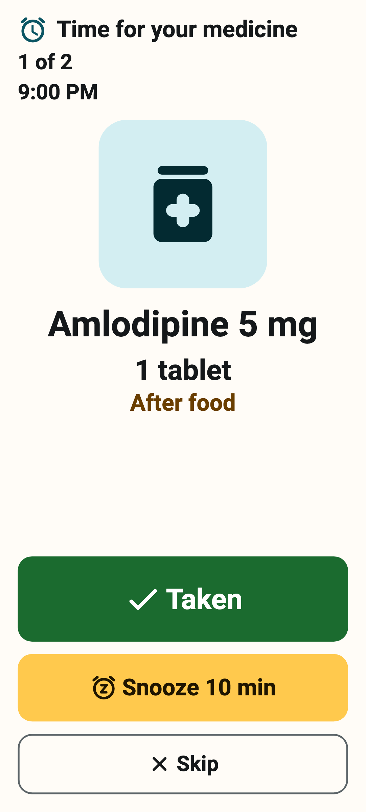
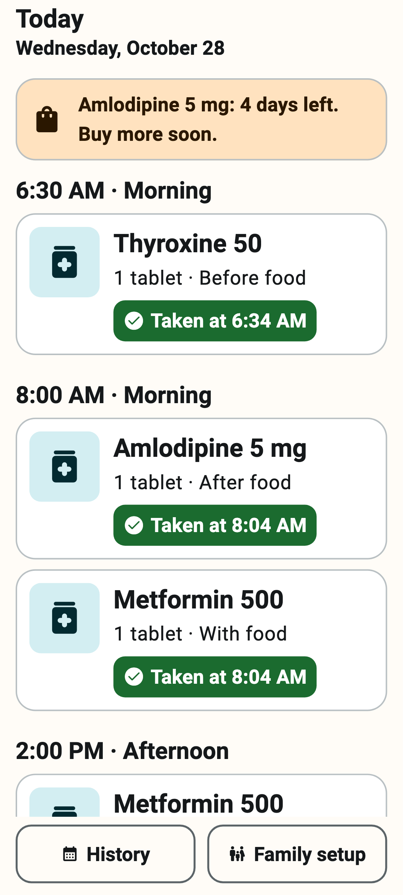
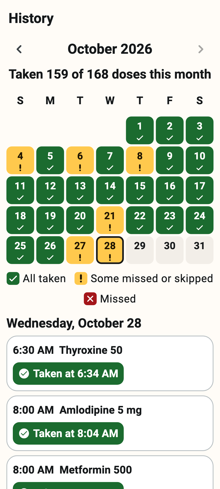
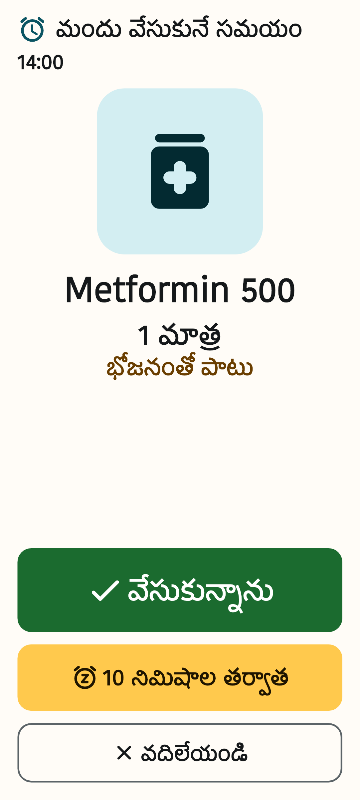

# Medicine Reminder

[](https://github.com/ChandraChaan/medicine-reminder/releases/latest)
[](https://github.com/ChandraChaan/medicine-reminder/releases)
[](https://github.com/ChandraChaan/medicine-reminder/actions/workflows/ci.yml)


[](LICENSE)

**A medicine reminder made for elderly parents.** At medicine time the phone rings like an alarm, shows the medicine (with a photo of the strip) in very large letters and reads it out in **Telugu, Hindi or English**: *"It's time for your BP tablet, after food."* One tap on **Taken** and it's done.

A son or daughter sets it up once. Everything stays on the phone: no account, no internet, no ads, no tracking.

<p align="center">
  
  
  
  
</p>

> [!IMPORTANT]
> This app is a reminder aid. It is **not medical advice** and does not replace a doctor or pharmacist. Always follow the prescription. Phones can be switched off, run out of battery or be set to silent, so please don't rely on any app alone for critical medicines.

## Download

**[Download the latest APK →](https://github.com/ChandraChaan/medicine-reminder/releases/latest)**

| File | For |
|---|---|
| `MedicineReminder-<version>-arm64-v8a.apk` | Almost every phone from the last 6–7 years (pick this if unsure) |
| `MedicineReminder-<version>-armeabi-v7a.apk` | Older 32-bit phones |
| `MedicineReminder-<version>-universal.apk` | Any phone (bigger download) |

Open the file on the phone and allow installing from your browser or file manager when Android asks. Every release lists SHA-256 checksums in `SHA256SUMS`, and every APK is signed with the same release key, so new versions install as updates and keep your data.

## What it does

- **Alarms that are hard to miss.** Exact alarms that ring with the alarm sound (not a quiet notification), turn the screen on and open over the lock screen. The alarm rings for 20 seconds (or until the screen is touched), then the reminder is read out, and repeated a few times until someone answers.
- **Huge, simple alarm screen.** Photo of the strip, medicine name, dose and before/after food, then three very large buttons: **Taken**, **Snooze 10 min**, **Skip**. Several medicines at the same time are shown one after another.
- **Spoken reminder** in Telugu, Hindi or English using the phone's own text-to-speech voice. If the phone has no voice for the chosen language, it speaks English instead and Settings explains how to add the voice.
- **Refill warnings.** Optionally count tablets: each Taken counts one dose down, and the app warns a few days before they run out (you choose how many).
- **History calendar.** A month view of taken, missed and skipped doses, clear enough to screenshot and send to family.
- **Survives restarts.** Alarms are put back after the phone restarts, after an app update and when the time or time zone changes (an 8:00 dose stays at 8:00 local time when you travel).
- **Made for older eyes and hands.** Big text, high contrast, colours always paired with an icon and words, at least 48 dp tap targets, few choices per screen, and layouts that still work with Android's font size at 200%.
- **Three languages throughout:** English, తెలుగు, हिन्दी.

## Setting it up for a parent (5 minutes)

1. **Install** the APK on your parent's phone and open *Medicine Reminder*.
2. **Pick the language** your parent reads best, then tap **Allow reminders** and allow notifications. On Android 14 and newer, also allow *Alarm over the lock screen* if Android asks.
3. Tap **Family setup → Add medicine** and answer one question per screen:
   - the **name** as your parent calls it (for example "BP tablet") and, ideally, a **photo of the strip**;
   - **how much** each time (¼ and ½ tablets are fine);
   - **when** (morning, afternoon, night or any exact time);
   - **before or after food**;
   - **which days**, from which date, and until when (or no last day);
   - optionally, **how many tablets are in hand**, to get refill warnings.
4. Repeat for each medicine. Check the **Today** screen: every dose is listed with its time.
5. In **Family setup → Settings**, check that all three *Alarm permissions* say **On**.
6. Show your parent the alarm screen once: tap a dose on Today to see the same big buttons.

**Tips**
- Keep the phone's **alarm volume** up (alarm volume is separate from the ringer volume).
- On some phones (Xiaomi, Redmi, Realme, Oppo, Vivo, OnePlus) set battery usage for *Medicine Reminder* to **No restrictions** / **Don't optimise**, and allow **Autostart** if the phone has that setting. These phones can stop apps in the background more aggressively than Android itself.
- A dose with no answer counts as **missed** after 1 hour by default; change it to 30 minutes or 2 hours in Settings.

## Permissions, and why

| Permission | Why |
|---|---|
| Notifications (`POST_NOTIFICATIONS`) | To show the reminder and play the alarm sound. Asked once at setup. |
| Exact alarms (`USE_EXACT_ALARM`, and `SCHEDULE_EXACT_ALARM` on Android 12) | So reminders ring at the exact minute, even when the phone is idle. On Android 12 you may need to turn on *Alarms & reminders*; the app shows a **Fix** button if it's off. |
| Full-screen alarm (`USE_FULL_SCREEN_INTENT`) | To open the alarm screen over the lock screen, like a clock alarm. Android 14+ lets you turn this off; the app shows a **Fix** button if it is. |
| Run at startup (`RECEIVE_BOOT_COMPLETED`) | To put the alarms back after the phone restarts. |
| Vibrate (`VIBRATE`) | To vibrate with the alarm. |

There is **no internet permission**: the app cannot send anything anywhere. The camera is only opened through Android's own camera app when you choose *Take a photo*.

## Privacy

- Medicines, photos and history are stored **only on this phone**, in the app's private storage.
- No account, no cloud, no analytics, no ads, no crash reporting.
- Android's automatic app backup is turned off for this app, so health data is not copied to a cloud backup.
- Uninstalling the app deletes everything.

## Build from source

Needs Flutter 3.44 (stable) and the Android SDK (compile SDK 37).

```bash
flutter pub get
flutter test
flutter run
```

Release APKs are built with `flutter build apk --release --split-per-abi --obfuscate --split-debug-info=build-symbols` (plus a universal build) and signed with a key that is not in this repository.

### How it works

- **Scheduling is plain Dart** ([`schedule.dart`](lib/features/doses/domain/schedule.dart)): it works out every dose in wall-clock time, its status (upcoming, due, snoozed, taken, skipped, missed) and the alarms for the next 7 days. It is unit-tested for day boundaries, snoozes across midnight, skips, time zones and clock jumps.
- **Android keeps the alarms** ([`AlarmScheduler.kt`](android/app/src/main/kotlin/dev/chandra/medicine_reminder/alarm/AlarmScheduler.kt)): the planned alarms are stored as *date + minute of day* and registered with `AlarmManager.setAlarmClock`. After a reboot or a time/zone change, [`RescheduleReceiver`](android/app/src/main/kotlin/dev/chandra/medicine_reminder/alarm/RescheduleReceiver.kt) re-registers them in the current time zone without starting Flutter.
- **When an alarm fires**, [`AlarmReceiver`](android/app/src/main/kotlin/dev/chandra/medicine_reminder/alarm/AlarmReceiver.kt) posts an insistent alarm-category notification with a full-screen intent, which opens the [alarm screen](lib/features/doses/presentation/alarm_screen.dart). The screen lets it ring for 20 seconds, then speaks the reminder and records the answer; every change re-plans the alarms.

Tests: `flutter test` runs the unit tests (scheduling, missed-dose detection, refill maths, storage, alarm payloads, translation completeness), widget tests (alarm screen, setup flow, home, history) and accessibility checks (tap targets, labels, contrast, 200% text at 320 dp width). README screenshots are rendered by `flutter test test_screenshots --update-goldens`.

## Contributing

Bug reports and ideas are welcome in [Issues](https://github.com/ChandraChaan/medicine-reminder/issues) and [Discussions](https://github.com/ChandraChaan/medicine-reminder/discussions). Translations into more Indian languages are especially welcome: copy `lib/l10n/app_en.arb` to `app_<code>.arb`, translate, and the completeness test tells you if anything is missing.

## License

[MIT](LICENSE) © Chandra ObulaReddy
